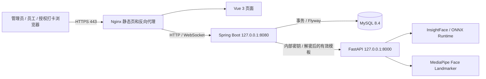
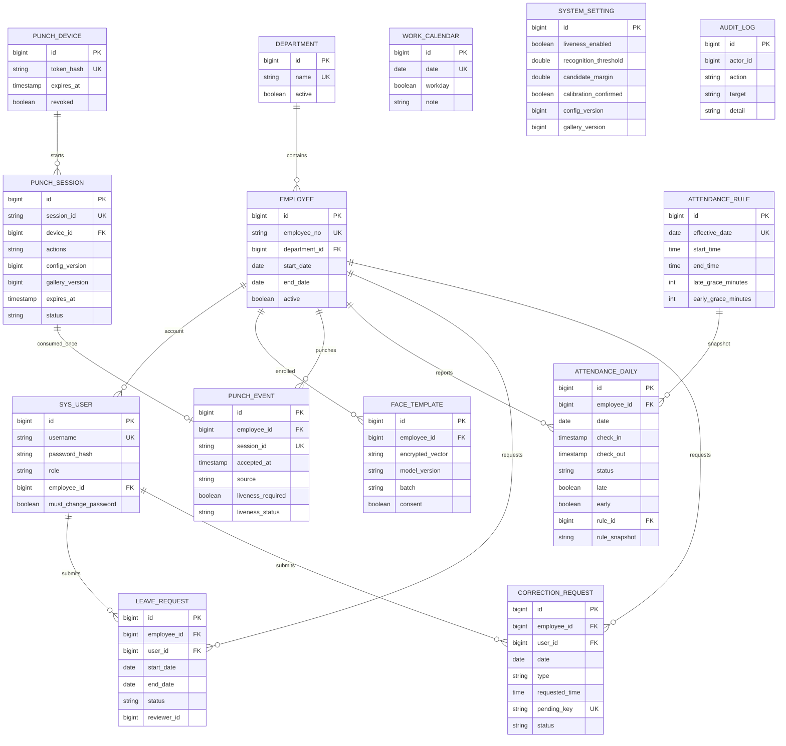

# 系统架构与数据关系

浏览器仅访问Java业务API。身份、动作通过结果、打卡接受时间、配置/人员库版本均由服务端复核。Python不读取业务数据库；Java以AES-GCM保存模板，内部同步时才解密。相机图像与动作视频不作为持久业务数据保存。

关系图展示业务关系；数据库外键与具体字段以 `backend/src/main/resources/db/migration/V1__initial_schema.sql` 为准。所有表均有创建/更新时间和版本字段；日报对员工与日期建立联合唯一约束，成功事件对会话编号建立唯一约束，待处理补卡通过唯一键和事务限制重复申请。

考勤日报是原始事件、审批产生的人工修正、请假、规则快照和工作日历的汇总结果。规则从次日生效，工作日历仅允许设置未来例外；历史事件不因批准补卡被覆盖。

事务连接使用 `READ COMMITTED`，并在业务写入前持有系统设置行的悲观锁，以适应100人以内的单机规模。这样等待锁后的查询可以读取前一个事务已经提交的记录，避免重叠请假、重复事件等检查使用旧快照。MySQL默认 `REPEATABLE READ` 的普通查询保留首次读取时的快照，不能仅凭后续拿到写锁就假设其他查询自动刷新，参见[MySQL一致性读取说明](https://dev.mysql.com/doc/refman/8.4/en/innodb-consistent-read.html)。生产并发仍须在MySQL8.4进行独立验收。

