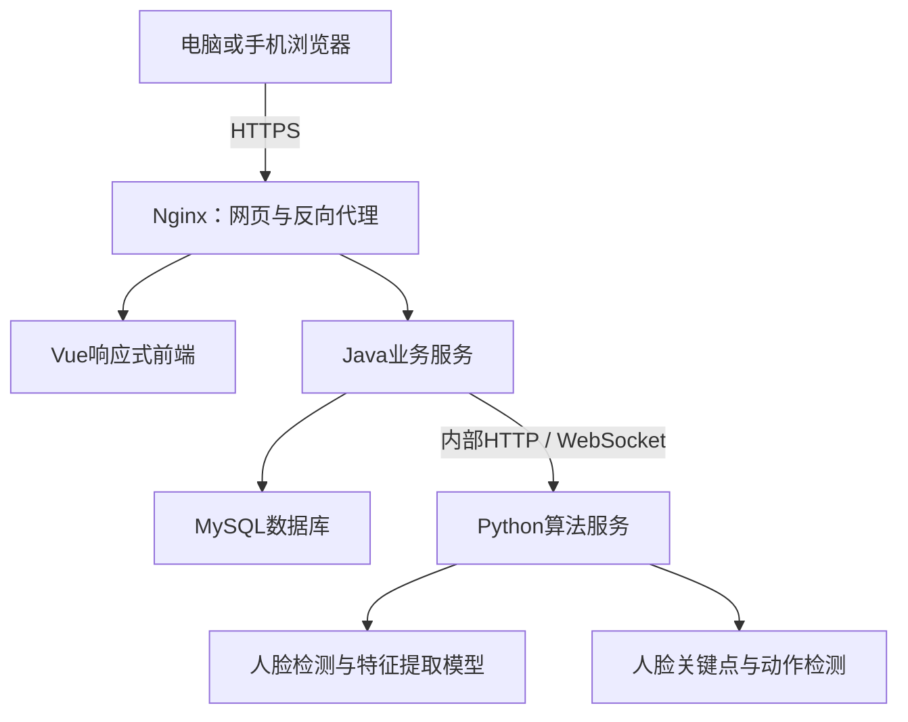

# 基于 Python 深度学习与 Java 的人脸识别考勤系统实施方案

## 一、项目目标与实施范围

项目名称建议为：**《基于深度学习的人脸识别考勤系统的设计与实现》**。

建设一套适合毕业设计展示的小型考勤系统：使用普通电脑或手机摄像头采集人脸，在公共打卡页面中直接识别人员身份，完成上下班考勤；管理员通过后台管理人员、人脸、考勤规则和审批，员工登录后查看记录、提交请假和补卡申请。

已确定的实施条件：

| 项目 | 实施方案 |
|---|---|
| 使用目的 | 毕业设计、学习及小规模试点 |
| 人员规模 | 第一版支持100人以内 |
| 打卡设备 | 普通电脑、手机自带摄像头 |
| 打卡方式 | 公共设备直接刷脸，采用1:N人员库检索 |
| 前端形式 | 一套响应式网站，适配电脑和手机 |
| 业务后端 | Java |
| 算法服务 | Python，使用预训练深度学习模型 |
| 防代打卡 | 管理员可开启或关闭随机动作活体检测 |
| 部署方式 | 一台电脑运行服务，同一局域网内的电脑和手机访问 |
| 人脸录入 | 管理员现场核对身份后采集 |
| 开发周期 | 按8周安排，第6周形成完整可演示版本 |

第一版完成固定日班、上下班打卡、迟到早退、缺卡缺勤、整天请假、补卡审批和统计导出。跨夜班、轮班、小时级请假、薪资计算、GPS定位、多租户和原生手机App留作后续扩展。

**完成标准：能够连续演示“人员建档→录入人脸→公共刷脸打卡→考勤计算→申请审批→报表导出”的完整过程。**

## 二、系统架构与技术选型

### 2.1 整体架构

浏览器只访问Java提供的业务接口。Python服务不直接面向浏览器，也不直接操作业务数据库。

### 2.2 技术选型

| 层级 | 技术 | 用途 |
|---|---|---|
| 前端 | Vue 3、TypeScript、Vite | 页面与交互 |
| UI组件 | Element Plus、响应式CSS | 管理页面、表单和移动端适配 |
| 状态与路由 | Pinia、Vue Router | 登录状态、权限页面 |
| 数据展示 | ECharts | 考勤趋势和状态分布 |
| Java服务 | Java 21、Spring Boot、Spring Security | 业务接口、登录和权限 |
| 数据访问 | Spring Data JPA、Flyway | 数据操作、数据库版本管理 |
| 数据库 | MySQL 8.4 LTS | 持久化存储 |
| Python服务 | Python 3.11、FastAPI | 算法接口与会话处理 |
| 图像处理 | OpenCV、NumPy | 图像解码、质量检测和特征计算 |
| 人脸识别 | InsightFace、ONNX Runtime CPU | 人脸检测、对齐、特征提取 |
| 动作检测 | MediaPipe Face Landmarker | 眼睛、嘴部动作判断 |
| Excel导出 | Apache POI | 导出考勤明细和月报 |
| 接口文档 | OpenAPI | Java与Python接口说明 |
| 部署 | Nginx、独立进程、启动脚本 | 局域网运行与HTTPS访问 |

依赖在第一周完成安装、模型加载和真机验证后锁定版本，形成Java构建文件、前端锁文件和Python依赖锁文件，后续按锁定版本开发。

InsightFace官方预训练模型有非商业研究使用限制，本项目按毕业设计研究用途选择模型并保留许可说明。[InsightFace官方说明](https://github.com/deepinsight/insightface)

### 2.3 服务职责

**Java负责：**

- 用户登录、角色权限和公共设备授权。
- 人员、部门、人脸模板的持久化管理。
- 考勤规则、打卡记录、日报月报。
- 请假补卡审批。
- 活体检测开关、会话有效期、重复请求控制。
- 审计日志与Excel导出。

**Python负责：**

- 检测是否存在人脸，是否为单人画面。
- 图像质量检查、人脸对齐与特征提取。
- 1:N检索和相似度计算。
- 连续画面中的人脸一致性检查。
- 随机动作检测。
- 返回身份候选、分数、检测状态和失败原因。

**Java最终决定是否生成有效考勤记录。**
## 三、功能模块与业务规则

### 3.1 角色与页面

| 角色或入口 | 功能 |
|---|---|
| 管理员 | 人员部门管理、人脸录入、设备授权、考勤规则、审批、统计、设置和日志 |
| 员工 | 登录、查看个人记录、提交请假和补卡申请、查看审批结果、修改密码 |
| 已授权公共打卡设备 | 无需员工登录，提供签到、签退、摄像头采集和结果提示 |

主要页面：

- 登录页。
- 公共刷脸打卡页。
- 员工个人首页、个人考勤、请假申请、补卡申请。
- 管理员仪表盘。
- 人员与部门管理、人脸录入。
- 打卡设备管理。
- 考勤规则与工作日历。
- 考勤明细、月度统计。
- 请假与补卡审批。
- 系统设置、操作日志。

手机端优先显示摄像头、动作提示、操作按钮和结果卡片；管理表格在手机端采用卡片或横向滚动。离开打卡页面时停止摄像头采集。

### 3.2 公共打卡设备授权

“直接刷脸”是员工不用登录，公共打卡页面本身仍需经过管理员授权。

流程：

1. 管理员在目标电脑或手机浏览器中登录。
2. 点击“授权本浏览器为打卡设备”，填写设备名称。
3. Java签发仅有打卡权限的设备凭证，存入安全Cookie。
4. 退出管理员账号，进入公共打卡页。
5. 管理员可在后台撤销设备授权。

设备凭证默认有效7天，可提前撤销。它属于浏览器授权，不能视为硬件级设备认证。

公共页面只显示本次结果和脱敏姓名、工号，不显示人员库、完整考勤表或其他员工的信息。

### 3.3 人员建档与人脸录入

1. 管理员创建员工，填写工号、姓名、部门和在职状态。
2. 系统创建员工账号，员工首次登录修改初始密码。
3. 管理员核对身份，展示采集用途及数据处理说明。
4. 通过摄像头采集正脸、轻微左转、轻微右转各1张合格图像。
5. Python检查单人、清晰度、亮度和姿态，提取特征。
6. 检查三张图像是否属于同一人，并检索是否疑似已绑定其他员工。
7. 成功后保存3份特征模板，更新人员库版本。

具体规则：

- 不提供照片文件上传录入入口。
- 多人、无人、明显模糊等情况提示重新采集。
- 疑似重复绑定时阻止本次录入，提示管理员核查已有档案。
- 更换人脸需重新核对身份，成功后整体替换旧模板。
- 离职、停用或删除模板后，该员工立即失去刷脸打卡资格。
- 人脸原图仅用于本次处理，默认不持久保存；保存加密特征模板和录入审计信息。

### 3.4 公共刷脸打卡

1. 用户选择“上班签到”或“下班签退”。
2. Java检查设备授权、时间窗口和当前算法配置。
3. 创建短时打卡会话。
4. 网页打开摄像头，提示单人正对镜头。
5. 连续采集画面，经Java转发Python。
6. Python检索人员库；未达到识别条件时拒绝。
7. 按系统设置决定是否完成动作检测。
8. Java复核人员状态、人员库版本和会话有效性。
9. 写入打卡事件，更新当日考勤。
10. 展示成功、重复打卡或具体失败原因，约3秒后清空身份展示。

失败原因至少区分：

`未检测到人脸`、`多人入镜`、`图像质量不足`、`未识别到已录入人员`、`身份不稳定`、`动作验证失败`、`验证超时`、`非打卡时段`、`设备未授权`、`算法服务不可用`。

不向公共页面暴露具体相似度、候选名单和人脸模板。

### 3.5 考勤计算规则

第一版采用全体员工共用的固定日班：

| 规则 | 默认值 |
|---|---|
| 时区 | Asia/Shanghai |
| 工作日 | 周一至周五，可通过日期例外设置调休或假期 |
| 上班时间 | 09:00 |
| 下班时间 | 18:00 |
| 迟到宽限 | 5分钟 |
| 早退宽限 | 5分钟 |
| 签到窗口 | 06:00—11:59:59 |
| 签退窗口 | 12:00—23:59:59 |
| 有效签到 | 当天首次成功签到 |
| 有效签退 | 当天最后一次成功签退 |
| 同类重复请求间隔 | 30秒内返回重复结果，不新增事件 |
| 日期归属 | 以服务器接收并接受该次打卡的时间为准 |

默认判定：

- 09:05:00及以前签到不算迟到，之后算迟到。
- 17:55:00及以后签退不算早退，之前算早退。
- 迟到、早退可以同时存在。
- 当天结束前，未完成部分显示“待签到”或“待签退”，不提前定为缺勤。
- 日终后仅有签到或签退，显示对应缺卡。
- 工作日两次都没有且无有效请假，显示缺勤。
- 批准的整天请假显示请假，不计缺勤。
- 非工作日不要求打卡，第一版不计算加班。

每日记录保存规则快照；规则修改从次日生效。工作日历仅允许修改未来日期，避免历史统计随设置变化。

原始打卡事件保留，考勤日报属于可重算结果。数据库唯一约束和事务保证同一员工同一天只有一份日报。

### 3.6 请假与补卡审批

**请假：**

- 第一版只支持整天请假，填写日期区间、类型和原因。
- 统计时只计算区间内的工作日。
- 不允许与待审批或已批准请假重复。
- 审批时若日期已有有效打卡或补卡，拒绝产生冲突，要求先核查记录。
- 状态为待审批、已批准、已驳回、已撤销。
- 员工只能撤销待审批申请，管理员单级审批。

**补卡：**

- 可申请最近7个已结束自然日中的工作日。
- 选择补签到或补签退，填写申请时间和原因。
- 时间须处于该日对应打卡窗口。
- 支持补缺卡、纠正异常记录；必须由管理员核对后批准。
- 批准后形成独立的人工修正记录，再重算日报。
- 保留原始事件，不直接覆盖原始打卡时间。
- 同一员工、日期、打卡类型只允许一个待审批申请。

管理员不能审批自己的申请，需要另一名管理员处理。系统允许创建多个管理员账号。

### 3.7 统计与导出

支持按日期、部门、人员和异常状态查询：

- 应出勤天数、完成上下班打卡天数。
- 迟到次数、早退次数。
- 缺卡天数、缺勤天数。
- 请假天数、批准补卡次数。

“完成打卡天数”可包含迟到早退；缺勤、缺卡、请假按日状态分别统计，避免指标含义混淆。

导出提供考勤明细、月度汇总两个工作表，并注明统计范围、导出时间和指标说明。

四、人脸识别与可选动作检测

### 4.1 人脸识别方案

默认采用InsightFace的预训练人脸检测及ArcFace特征提取流程，使用ONNX Runtime进行CPU推理。

处理步骤：

**图像解码→单人检测→质量检查→人脸对齐→特征提取→向量归一化→人员库检索。**

第一版人员库规模小，使用NumPy完成全量余弦相似度计算，不引入向量数据库：

- 每人保存3份模板。
- 查询特征与每人的3份模板分别比较，取最高分作为该人员分数。
- 第一候选达到识别阈值，并与第二候选具有足够分差才接受。
- 只有一个已录入人员时，只使用识别阈值。
- 多个连续合格画面需识别为同一人员，避免单帧误判。

阈值不直接照搬网络示例：用独立的校准样本确定识别阈值及候选分差，再固定参数进行测试。

Java保存加密模板，Python启动时通过内部接口加载解密后的有效模板到内存。录入、替换、停用后更新人员库版本；同步失败时暂停新的刷脸提交，恢复后重新同步，防止使用过期身份数据。

### 4.2 管理员可控的检测开关

系统提供两个模式：

| 模式 | 行为 |
|---|---|
| 关闭动作检测 | 单人质量检查、连续身份识别通过后打卡 |
| 开启动作检测 | 在上述条件之外，必须完成随机动作验证 |

开关仅管理员可修改，记录修改人、时间和前后值。开关变更立即使未完成打卡会话失效，用户重新开始。

每条打卡事件保存：

- 是否要求动作检测。
- 实际检测状态：通过、失败、跳过。
- 算法模型及配置版本。
- 会话编号和设备编号。

关闭时记录为“跳过”，不能记为“活体检测通过”。

### 4.3 动作检测实现

第一版实现两个动作：**眨眼、张嘴**，每次随机决定执行顺序。

MediaPipe Face Landmarker可以输出人脸关键点和表情系数，可用作动作判断基础；它本身不等同于完整的防伪认证产品。[MediaPipe官方文档](https://developers.google.com/edge/mediapipe/solutions/vision/face_landmarker/python)

检测流程：

1. Java创建绑定设备、打卡类型和有效期的随机会话。
2. 先采集自然睁眼、闭嘴的基准状态。
3. 提示完成第一个动作，再完成第二个动作。
4. 检查完整动作变化，如睁眼→闭眼→睁眼、闭嘴→张嘴→闭嘴。
5. 连续检查单人状态，并在基准、动作过程和结束时复核身份。
6. 全部通过后，由Java一次性消费会话并写入考勤。

采集建议初始值：

- 画面分辨率640×480。
- 每秒约6帧，采用JPEG二进制传输。
- 整次动作采集最长12秒。
- 会话总有效期60秒。
- 单帧不超过200KB，单会话不超过80帧、累计不超过12MB。

使用WebSocket由浏览器连接Java，再由Java转发Python；前端只负责采集和提示，动作结果由后端判断。超过体积、帧数、有效期或出现多人、身份变化时立即结束会话。

此方案用于验证对静态照片的抵抗效果。预录视频、实时换脸、虚拟摄像头等攻击不属于第一版承诺解决的范围，论文中需记录这一限制。

## 五、数据设计与接口设计

### 5.1 核心数据表

所有业务表使用主键、创建时间、更新时间；审批和配置表增加版本字段以控制并发修改。

| 表 | 主要字段与用途 |
|---|---|
| `sys_user` | 账号、密码哈希、角色、员工关联、启用状态 |
| `department` | 部门名称、状态 |
| `employee` | 唯一工号、姓名、部门、在职状态、生效日期 |
| `face_template` | 员工、加密向量、模型版本、模板批次、有效状态 |
| `attendance_rule` | 上下班时间、宽限、打卡窗口、生效日期 |
| `work_calendar` | 日期、是否工作日、例外说明 |
| `punch_device` | 设备名称、凭证摘要、有效期、撤销状态 |
| `punch_session` | 设备、挑战顺序、有效期、状态、配置及人员库版本 |
| `punch_event` | 员工、签到/签退、服务器时间、来源、设备、检测状态 |
| `attendance_daily` | 员工、日期、有效签到签退、各异常标志、规则快照 |
| `leave_request` | 员工、日期区间、请假类型、原因、审批状态 |
| `correction_request` | 员工、日期、类型、申请时间、原因、审批状态 |
| `system_setting` | 动作检测开关、识别阈值、配置版本 |
| `audit_log` | 操作人、操作对象、动作、时间、脱敏变更信息 |

关键约束：

- 工号、账号唯一。
- 日报按“员工＋日期”唯一。
- 成功消费的打卡会话只能生成一次事件。
- 原始事件、审批和配置变更可追溯。
- 停用员工不参加生效日期之后的应出勤统计，历史记录保留。

### 5.2 Java对外接口

统一前缀为 `/api/v1`，普通接口使用JSON，图片采用multipart，连续画面使用WebSocket。

| 接口组 | 主要能力 |
|---|---|
| `/auth` | 登录、退出、获取当前用户、修改密码 |
| `/employees`、`/departments` | 人员和部门管理 |
| `/employees/{id}/face` | 现场录入、替换、删除人脸模板 |
| `/devices` | 授权当前浏览器、列表、撤销 |
| `/kiosk/sessions` | 创建会话、取消会话、查询结果 |
| `/kiosk/stream` | 上传帧、接收动作提示与最终结果 |
| `/attendance` | 个人记录、管理查询、月度统计、导出 |
| `/leave-requests` | 申请、撤销、批准、驳回 |
| `/correction-requests` | 申请、撤销、批准、驳回 |
| `/rules`、`/calendar` | 固定班次和工作日历 |
| `/settings`、`/audit-logs` | 系统设置和审计查询 |

普通接口统一返回业务码、提示、数据和请求编号；列表分页。登录账号和设备凭证使用不同权限体系。

前端不提交可信的员工身份、识别通过标记或最终打卡时间；这些信息由服务端确定。

### 5.3 Python内部接口

| 接口 | 用途 |
|---|---|
| `GET /internal/health` | 检查模型加载状态与人员库版本 |
| `POST /internal/face/extract` | 检查录入图像并提取特征 |
| `PUT /internal/gallery` | 原子替换有效人员库及版本 |
| `POST /internal/sessions` | 创建算法检测会话 |
| `WS /internal/sessions/{id}/stream` | 接收连续帧并输出检测事件 |
| `DELETE /internal/sessions/{id}` | 取消并释放会话 |

Python最终结果包含员工候选ID、相似度、候选分差、动作状态、失败原因、模型版本及人员库版本。Java复核后再决定写库。

内部服务使用独立密钥，仅监听本机回环地址；Python不接收浏览器直接调用。

六、部署、数据保护与故障处理

### 6.1 局域网部署

默认在Windows开发电脑运行：

- Nginx提供HTTPS和前端静态页面。
- Java监听本机8080端口。
- Python监听本机8000端口。
- MySQL仅允许本机连接。
- 手机和其他电脑通过部署电脑的局域网地址访问HTTPS站点。

为部署电脑固定局域网地址，证书包含实际访问的IP或域名，并在参与演示的手机、电脑上安装并信任开发证书。手机访问普通HTTP局域网地址通常无法正常使用摄像头，必须在第一周验证。[浏览器摄像头要求](https://developer.mozilla.org/en-US/docs/Web/API/MediaDevices/getUserMedia)

首期采用原生进程和启动、停止脚本，降低Windows上的部署复杂度。提供环境检查脚本，检查端口、数据库、模型文件和证书。

### 6.2 资源与运行方式

以四核CPU、16GB内存、可用摄像头作为初始演示环境，最终性能通过实测确认，不要求独立显卡。

Python初期运行一个模型进程，模型启动时加载一次，最多同时处理两个打卡会话；超出时提示设备繁忙并允许重试。模型服务增加worker会复制模型内存，因此不能只按CPU核数直接扩容。[FastAPI部署说明](https://fastapi.tiangolo.com/deployment/concepts/)

启动顺序：

**MySQL→Java基础服务→Python加载模型与人员库→健康检查通过→开放打卡。**

### 6.3 数据保护

- 密码使用BCrypt哈希。
- 人脸模板使用AES-GCM加密，密钥放在独立配置中，不进入源码和数据库备份。
- 不持久化人脸采集原图、动作视频。
- 日志不记录图像、完整特征、密码和凭证。
- 提供人脸删除及停用入口。
- 打卡事件及一般日志默认保留至项目验收后30天，随后清理或匿名化。
- 本地备份仅覆盖结构化数据，模板随数据库以加密形式备份；备份滚动保留7天。
- 提供人工补录方式作为摄像头故障、识别困难或不参与刷脸人员的替代途径，必须注明来源并留痕。

涉及真实人员试用时，增加采集告知和单独同意记录，并按适用要求确认保存期限、删除与替代方式。不能仅因属于毕业设计就默认真实考勤应用免除相关义务。[人脸识别技术应用安全管理办法](https://www.cac.gov.cn/2025-03/21/c_1744174262156096.htm)

### 6.4 故障与恢复

| 故障 | 处理 |
|---|---|
| 摄像头权限被拒绝 | 提示打开权限，允许重试 |
| 模型未加载或服务超时 | 不生成成功考勤，保留失败原因 |
| 人员库同步失败 | 暂停新打卡，重新同步后恢复 |
| 网络中断 | 当前会话失败；重连后重新开始，不支持离线成功打卡 |
| 数据库提交失败 | 返回失败，使用会话编号查询是否已提交，防止重试重复写入 |
| 服务重启 | 未完成会话失效，人员库重新加载 |
| 日终任务遗漏 | 启动时及定时任务补算未完成日期，按原始事件和快照重算 |

运行页显示数据库、算法服务、模型和人员库状态；日志用请求编号关联Java和Python调用，方便答辩现场排错。

## 七、开发进度与阶段交付

| 周次 | 工作内容 | 验收成果 |
|---|---|---|
| 第1周 | 固化需求、页面草图、环境搭建；完成模型提取和1:N检索验证；验证手机HTTPS摄像头及帧传输 | 技术验证报告、锁定依赖、手机真机采集可用 |
| 第2周 | Java登录权限、人员部门、数据库迁移；前端基础布局；公共设备授权 | 管理员和员工可登录，设备可授权与撤销 |
| 第3周 | 管理员现场录入、人脸库同步、关闭动作检测时的刷脸打卡 | 录入到签到签退完整打通 |
| 第4周 | 随机动作检测、WebSocket提示、身份连续性检查、开关及会话校验 | 可演示开启与关闭的差异 |
| 第5周 | 固定班次、日历、日报计算、个人与管理查询 | 各考勤状态与时间边界正确 |
| 第6周 | 请假补卡审批、统计导出、完整业务联调 | 形成可演示完整版本 |
| 第7周 | 阈值校准、独立测试、手机兼容与性能测试、安全检查 | 实验数据、缺陷修复记录 |
| 第8周 | 部署脚本、恢复测试、操作说明、论文图表和演示材料 | 最终系统与毕业设计交付包 |

第3周优先保证基础闭环，第6周完成全部必需业务，第7—8周集中验证和准备答辩。静默防伪模型不插入本轮关键路径。

## 八、测试、实验与最终交付

### 8.1 业务验收

必须覆盖：

- 普通员工不能访问管理员功能，也不能读取他人记录。
- 未授权或已撤销设备无法打卡。
- 同一会话重复提交只产生一次成功事件。
- 签到取首次，签退取最后一次。
- 09:05与17:55的边界、窗口边界、跨日期请求处理正确。
- 迟到与早退可同时出现；日终前后状态正确变化。
- 工作日历、规则快照、员工停用日期不破坏历史统计。
- 请假重叠、请假与打卡冲突、重复补卡申请被正确处理。
- 审批并发只生效一次，人工修正保留原记录。
- 重启后缺失日报能够补算。
- 页面查询、月度统计与Excel导出结果一致。

### 8.2 人脸与动作检测实验

在参与者知情同意下，建议邀请10—20名人员：

- 每人3张录入图像。
- 单独采集校准样本和测试样本，不复用同一图像。
- 包含正常光照、偏暗、轻微侧脸、戴眼镜及不同距离。
- 留出未录入人员，测试未知人员是否被错误接纳。
- 对比“单帧识别”和“连续画面确认”。
- 分别测试动作检测开关状态下的打印照片、手机照片和预录视频攻击。
- 测试多人入镜、中途换人、动作不完整和超时。
- 尝试修改前端开关、伪造通过字段、重放旧会话，确认后端拒绝。

报告指标：

| 方向 | 指标 |
|---|---|
| 人脸识别 | 正确识别率、错误身份接受率、未知人员误接受率、真人拒绝率 |
| 动作检测 | 真人通过率、照片攻击通过率、视频重放通过率 |
| 性能 | 首次启动时间、识别耗时P50/P95、完整打卡耗时、内存占用 |
| 可用性 | 手机与电脑通过情况、失败原因分布 |

初步目标为正常室内条件下正确识别率不低于95%、真人动作通过率不低于90%；关闭动作检测时服务端识别耗时P95争取不超过2秒，开启动作检测时大部分完整操作在12秒内完成。

这些是待验证目标。所有结果都需注明设备、样本人数、测试次数和测试条件；样本不足时不能宣称商业级准确率或安全性。照片攻击拒绝率争取达到90%以上，视频重放单独报告，不混入照片结果。

### 8.3 浏览器与部署验收

至少完成：

- Windows Chrome、Edge。
- Android Chrome真机。
- iPhone Safari真机；若暂时无法取得设备，明确列为未验证项。
- 摄像头拒绝授权、摄像头被占用、切换页面释放摄像头。
- 两台设备同时打卡、第三台设备繁忙提示。
- 断网、算法服务停止、数据库异常、系统重启。
- 备份恢复后，账号、考勤与加密模板均可正常使用。

### 8.4 最终交付物

1. **源码**：前端、Java业务服务、Python算法服务。
2. **数据库**：ER图、迁移脚本、脱敏演示数据。
3. **算法材料**：模型来源与许可、版本与校验值、阈值校准方法。
4. **接口文档**：业务接口、内部算法接口、WebSocket消息及错误码。
5. **部署材料**：依赖锁定文件、配置示例、HTTPS配置、启动停止和备份恢复说明。
6. **测试材料**：功能测试表、算法实验数据、性能及兼容性报告。
7. **使用手册**：管理员、员工和公共打卡操作说明。
8. **答辩材料**：架构图、业务流程图、实验图表、演示脚本。

答辩演示按“管理员录入→关闭动作检测打卡→开启后真人动作打卡→照片攻击测试→异常考勤→补卡审批→导出月报”的顺序组织；照片攻击展示真实结果，不预设一定成功或失败。

本方案以**完整业务系统、可解释的深度学习推理流程、可开关的动作检测，以及有实测依据的实验评估**作为毕业设计的主要成果。